


 

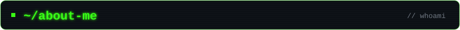

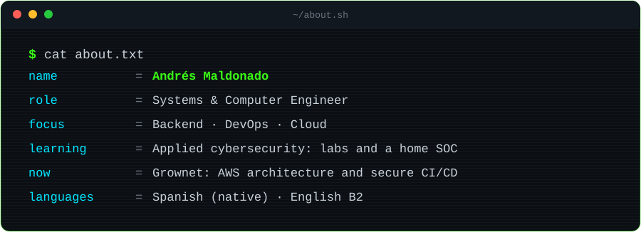

 

I build backend services and the infrastructure that runs them: **Java/Spring**, **TypeScript/NestJS**, **Docker**, **CI/CD** and **cloud (AWS and Azure)**. I treat security as part of the design rather than a patch at the end: JWT and OTP authentication, SQL injection prevention and auditing of vulnerable dependencies. Right now I'm taking it further with hands-on labs and a home SOC.

| Backend | DevOps & cloud | Security |
|---|---|---|
| APIs and microservices with Java/Spring, NestJS and Node | Containers with Docker and pipelines on GitHub Actions | JWT, OTP, OWASP and SQL injection prevention |
| Data modeling and optimization in PostgreSQL, with Redis caching | Architecture on AWS and services on Azure | Dependency audits and security rules on repositories |
| Service integration and gateways | Observability with traces, Grafana and KQL workbooks | Labs with Kali, Burp Suite, Nmap and sqlmap |

<b>Backend & web</b>

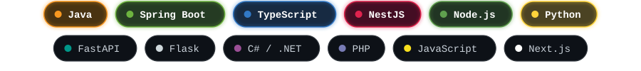

<b>Databases</b>

<b>DevOps & cloud</b>

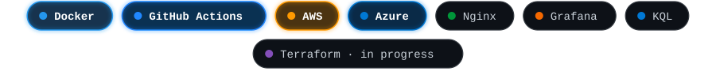

<b>Security</b>

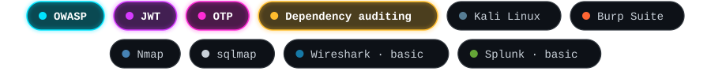

Glowing tags are what I use the most today. Gray-outlined tags are technologies I've already worked with.

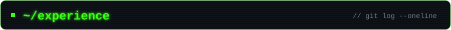

 

<b>Grownet</b> · Backend, DevOps & Cloud · <i>Sep 2026 - Present</i>

 

A team that receives client projects and delivers them under the Grownet name. I take care of backend, DevOps, cloud and security.

- Designed the **conceptual AWS architecture** for a mobile and web platform to manage electric vehicle charging stations: a driver-facing app and an admin web panel.
- Set up the **project repositories with security rules and CI pipelines** from day one.
- I'll lead the backend with **NestJS**, infrastructure as code with **Terraform**, DevOps and security.

`AWS` · `NestJS` · `Terraform` · `GitHub Actions` · `CI/CD`

<b>CI&T</b> · Engineer Intern · <i>Jul 2025 - Jan 2026</i>

 

**Employee feedback system**

- Built services with **Java/Spring**, **Next.js**, **Python** and **Node.js**.
- Implemented security with **JWT** and **OTP** login for external evaluators.
- Used **PostgreSQL** as the database and **Nginx** as the gateway, which was later migrated to a JavaScript gateway.
- Containerized the solution: wrote the **Dockerfile for each of the 3 microservices** and the `compose.yml`.

**Transactional chatbot on Azure**

- Worked with the bot SDK in **.NET and C#**, deployed on **Azure**, with **Azure Functions** in TypeScript and **Cosmos DB**.
- Fixed issues in the application core, including a Newtonsoft.Json serialization exception in C#, using Azure traces and Grafana for logs.
- Built **KQL workbooks** to visualize service metrics and API consumption.
- Audited the dependencies of the TypeScript Functions and fixed outdated packages and ones with **critical vulnerabilities** before production.
- Migrated a CSV of **5,000+ Brazilian cities** into **PostgreSQL** so it could be queried with SQL, then added **Redis** as a cache to speed up reads even further.
- Created a **GitHub Actions pipeline** that requires unit tests to pass on pull requests into the main branches.

`Java` · `Spring` · `Next.js` · `TypeScript` · `.NET` · `C#` · `Azure` · `Cosmos DB` · `PostgreSQL` · `Redis` · `Docker` · `Nginx` · `GitHub Actions` · `KQL`

<!-- TODO (optional): add measurable results, e.g. read-time improvement after the Postgres/Redis migration. -->

<b>Jucoing</b> · Backend Developer (Freelance) · <i>Jun - Dec 2024</i>

 

- Developed a web system with **PHP** and **MySQL**: an informational website that loads its content from the database.
- Applied security measures to **prevent SQL injection**.
- Built an **admin panel** so administrators can manage the site's content on their own.

`PHP` · `MySQL` · `Web security`

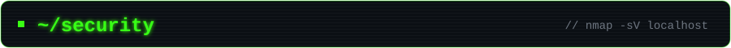

 

| Status | What it includes |
|:-:|---|
| Done | **Google Cybersecurity Certificate** |
| Done | Academic labs with **Kali Linux, Burp Suite, Nmap and sqlmap** |
| Done | Security applied in real projects: JWT, OTP, SQL injection prevention, dependency audits and repository security rules |
| Done | First steps with **Wireshark** and **Splunk** (basic level) |
| In progress | More labs to publish, plus platforms like TryHackMe and Hack The Box |
| In progress | A **home SOC**, documented in a repository |
| Planned | **CompTIA Security+** and **AZ-900** |

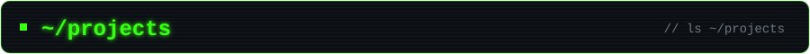

 

| Project | Description | Status |
|---|---|---|
| **Secure Login** | An authentication system built around security best practices. | To be published |
| **Home SOC** | A home lab for monitoring and threat detection, documented step by step. | Planned |

Grownet client projects are private. This is where I'll share my own security-focused projects.

<!-- TODO: when you publish each repo, link the name: [**Secure Login**](https://github.com/maldoA10/REPO-NAME) -->

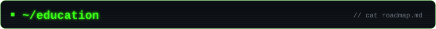

 

| | |
|---|---|
| **Degree** | Systems and Computer Engineering |
| **Certifications** | Google Cybersecurity Certificate |
| **Languages** | Spanish (native) · English (B2, upper-intermediate) |
| **On my radar** | CompTIA Security+ · AZ-900 · TOEFL or IELTS · JLPT |

<!-- TODO (optional): add your university and graduation year. -->

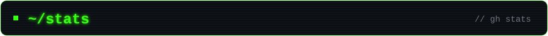

 

 

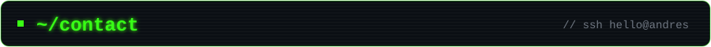

 

 

If you're looking for someone for backend, DevOps or cloud work with a security mindset, get in touch.

  

